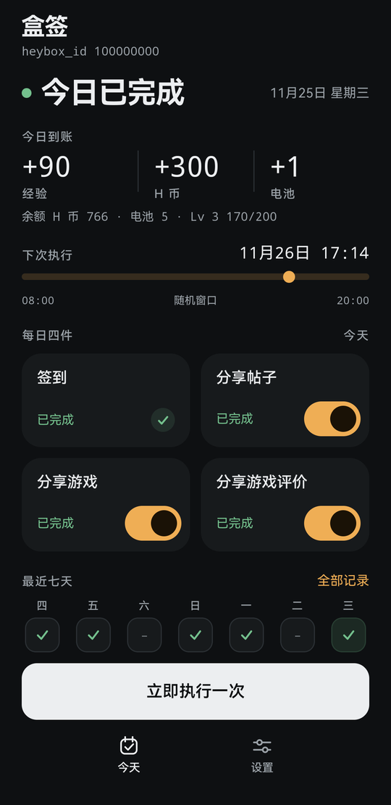
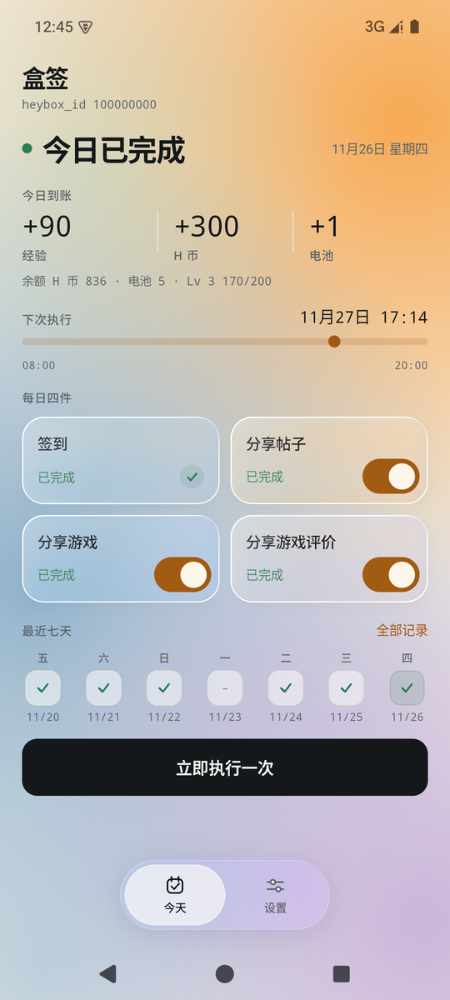
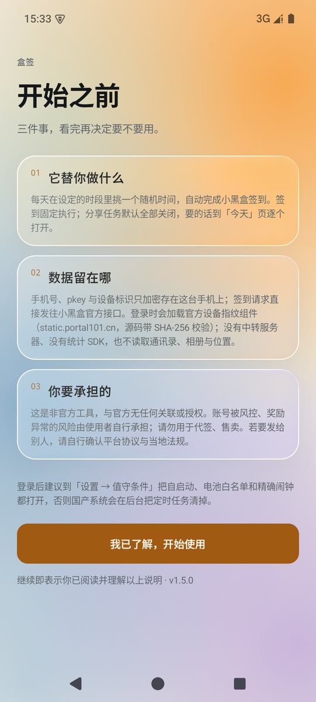
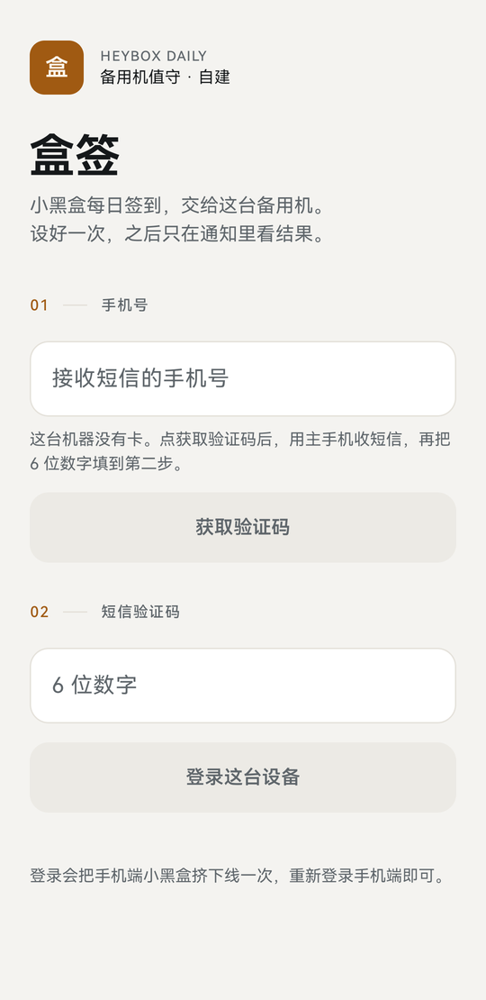
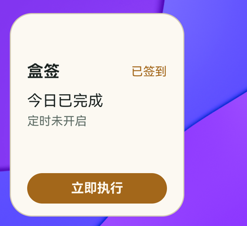

# 盒签

小黑盒每日自动签到 · Android 原生 · 协议层直调官方接口


装在不插 SIM 卡的备用机上，每天在你设定的时段里随机挑一个时刻，自动完成小黑盒签到。跑完给你一条通知，平时不用打开 App。

不跑 Docker、不用无障碍点击、没有中转服务器，登录凭据只加密存在这台手机上。

> **非官方工具**：与小黑盒官方无关联或授权，仅供个人学习自用。请勿用于代签、售卖等商业行为；账号风险与平台协议请自行评估。

## 截图

| 首页 · 夜间 | 首页 · 白天 |
| :---: | :---: |
|  |  |

| 首启说明 | 登录 |
| :---: | :---: |
|  |  |

桌面小组件（华为 EMUI 会把 4×1 卡片拉成方形）：



截图中的 `heybox_id` 与账户余额已隐去。

## 下载安装

到 [最新 Release](https://github.com/huututu939/heybox-checkin/releases/latest) 下载 `app-release.apk`，允许「安装未知来源应用」后侧载。

- 需要 Android 8.0 及以上
- 备用机建议长期插电，关掉系统对它的省电限制
- debug 包与 release 包签名不同，不能互相覆盖安装

## 它能做什么

- **每天自动签到**：在可配置时段（默认 08:00–20:00）内随机挑时刻，跑完自动排下一天
- **可选分享**：分享帖子 / 游戏 / 评价三个独立开关，**默认全关**，需要就自己打开
- **结果可见**：成功失败都有通知，失败通知上带「立即重试」
- **首页账单**：今日增量、账户余额、最近七天记录
- **登录过期可恢复**：首页提示重新登录，定时、外观、历史都保留
- **两套外观**：夜间 / 白天，可跟随系统；4×1 与 2×2 桌面小组件
- **首启说明**：开始之前把「它做什么、数据去哪、你要承担什么」讲清楚

## 首次登录

```text
备用机：输入手机号 → 获取验证码
主手机：收到短信 → 把 6 位数字念回 / 发回备用机
备用机：填验证码 → 登录
```

- 首次获取验证码要加载官方设备指纹组件，可能要十几秒
- 验证码几分钟内有效，超时重新获取
- 登录带「新设备」标记，会把手机端小黑盒挤下线一次，重新登录手机端即可

手机号、登录凭据、设备标识用 Android Keystore 加密，只存在这台机器上。

## 装好之后

国产 ROM 会在夜里清理后台，首页「值守条件」可以逐项自查：

| 条件 | 作用 |
| --- | --- |
| 通知权限 | 显示执行进度和结果 |
| 忽略电池优化 | 降低夜间被杀的几率 |
| 精确闹钟（Android 12+） | 保证定时准时触发 |
| 自启动 / 后台运行 | 防止 ROM 清理，按机型图文指引手动打开 |

三项系统权限都能一键跳转，唯独「自启动」在部分 ROM（如 EMUI）被系统锁住，只能按指引手动确认。

## 常见问题

| 现象 | 说明 |
| --- | --- |
| 签到成功但经验 / H 币没到账 | 平台风控，换网络只能缓解，不能保证 |
| 提示需要人机验证 | 暂未实现验证码页，需要手动去官方 App 完成 |
| 某天完全没跑 | 多半是后台被杀，检查「值守条件」四项 |
| 首页显示「登录已过期」 | 点重新登录，历史与定时不会丢 |
| 提示设备令牌组件已更新 | 官方指纹 SDK 升版了，需要更新常量后重新编译 |
| 今天显示「已由其它入口完成」 | 当天已在官方 App 或其他设备签到，本次不会重复执行 |

## 自己编译

需要 JDK 17、Android SDK 35：

```bash
./gradlew testDebugUnitTest
./gradlew assembleDebug
```

Windows 用 `gradlew.bat`，或在 `local.properties` 里写 `sdk.dir=...`。首次运行会下载 Gradle 8.13，网络受限时可直接用本机 Gradle 8.13+ 执行同名任务。

要出正式包，在仓库根目录放 `keystore.properties` 与 `keystore/`，再执行 `./gradlew assembleRelease`。**keystore 丢了就无法给已安装的用户覆盖升级，务必备份。**

仓库自身发版走 CI：推一个 `v*` tag 后，GitHub Actions 用 Secrets 里的 keystore 签名出包、校验签名与 versionCode、算 SHA-256，再自动建 Release；发版说明放在 `docs/release-notes/<tag>.md`。tag 与 `versionName` 对不上会直接失败。

## 许可

本项目以 **MIT License** 发布，完整文本见 [LICENSE](LICENSE)。

签到与分享流程、请求签名、设备指纹实现参考并移植自 [`Cansiny0320/heybox-daily`](https://github.com/Cansiny0320/heybox-daily)（MIT）与 [`XiaHouSheng/heybox-core`](https://github.com/XiaHouSheng/heybox-core)（MIT），第三方许可全文见 [THIRD_PARTY_NOTICES.md](THIRD_PARTY_NOTICES.md)，App 内「关于 → 开源许可」展示同一份文本。

> 本项目为非官方客户端，与小黑盒官方无任何关联或授权。因使用本工具产生的账号风险或数据异常，由使用者自行承担。
